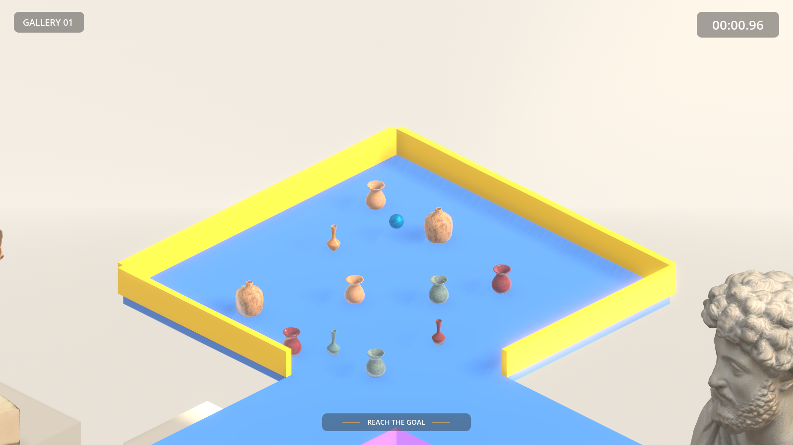

# Marble Madness 3D Clone

A 3D clone of *Marble Madness* built in Godot 4.7.1 (.NET / C#) for COSC2349 Games Studio 2, Assignment 3. Roll a glass marble through three galleries of a bright museum, against the clock, past patrolling statues, suction wells, blowers, trampolines and wet floors.



See [docs/design-document.md](docs/design-document.md) for the game design, [docs/requirements.md](docs/requirements.md) for the full requirements spec, [docs/project-plan-responsibilities.md](docs/project-plan-responsibilities.md) for team roles and the milestone schedule, [docs/tile-convention.md](docs/tile-convention.md) for the tile grid and level-building rules, [docs/code-style.md](docs/code-style.md) for the shared C# conventions, and [docs/qa-checklist.md](docs/qa-checklist.md) for the pre-submission checks.

## Requirements

- [Godot 4.7.1 .NET/Mono build](https://godotengine.org/download) (not the standard build — C# support requires the .NET version)
- [.NET SDK 8.0](https://dotnet.microsoft.com/download/dotnet/8.0) or later

## Setup

1. Clone the repository.
2. Open Godot 4.7.1 (.NET), choose **Import**, and select this folder's `project.godot`.
3. On first open, Godot will prompt to build the C# solution (`MarbleMadness3D.sln`) — accept this, or run `dotnet build` from the repo root.
4. Press **Run Project** (F5). The game opens on the start menu (`scenes/ui/menus/startMenu.tscn`). To jump straight into Level 1 while testing, open `scenes/main/Main.tscn` and press **Run Current Scene** (F6).

## Controls

| Input | Action |
|---|---|
| WASD / arrow keys | Roll the marble (relative to the camera: W is up the screen) |
| Mouse wheel / Q, E | Zoom out / in (five zoom levels) |
| Esc | Pause / resume |

## How to play

- Roll from the start to the **goal**, the platform marked with a red flag.
- **Time:** the stopwatch counts up. Each gallery has its own star times: finish under them for three or two stars (Gallery 01: 30 s and 60 s, Gallery 02: 50 s and 80 s, Gallery 03: 1:15 and 2:00), and in any time under 5:00 for one. At 5:00 the run ends in a game over.
- **Checkpoints:** falling off the course puts you back at the last checkpoint you passed. The clock keeps running.
- **Hazards:** a patrolling caryatid statue knocks you away, a vacuum well pulls you into its wind and a blower pushes you out of it, a trampoline launches you upwards, and a wet floor takes away your control for a moment.
- **Vases:** you can knock them over. They slow you down a little.
- Galleries unlock in order. Clearing one with at least one star opens the next.

## Features

- Physics-driven marble (a real rigid body pushed by forces), with camera-relative controls
- Isometric follow camera with five zoom levels; a see-through marble wherever scenery hides it, and backdrop exhibits that fade out when they cover the course around the marble
- Three galleries built from one shared modular tile kit on Godot GridMaps, each themed by its own exhibits and music
- Patrolling, suction, blowing, bouncing and slippery hazards, checkpoints, a stopwatch with star grades, and saved best times
- Knock-over physics props
- Start menu, level select, pause menu, HUD and results screen
- Music per scene with crossfades; speed-based rolling and landing sounds; prop impacts; menu clicks; and sounds for checkpoints, the goal, game over, hazard hits, slips, trampoline bounces and falls

## Videos and presentation

- Video demonstration: [`VIDEO_DEMO.mp4`](VIDEO_DEMO.mp4) in the repository root (7 minutes, 1080p). Open it from your clone of the repository, or download it from the repository page.
- Milestone presentation: given in person in class.

## Project Structure

```
assets/      Art, models, textures, materials, audio, fonts, tile mesh libraries
resources/   Data resources (environments, tile definitions)
scenes/      .tscn scene files, grouped by system
scripts/     C# scripts, grouped by system
docs/        Design, requirements, planning and credits documentation
VIDEO_DEMO.mp4  Video demonstration
```

Folder-to-system mapping follows [docs/requirements.md §3](docs/requirements.md#3-core-systems--functional-requirements):

| Folder | System | Owner |
|---|---|---|
| `scenes/marble/`, `scripts/Marble/` | Marble controller | Donovan |
| `scenes/camera/`, `scripts/Camera/` | Camera system | Donovan |
| `scenes/tiles/`, `assets/libraries/` | Tile kit and GridMap mesh libraries | Aaron |
| `scenes/levels/` | Individual levels | Aaron (integration) |
| `scenes/environment/` | Backdrop pieces (columns, arches) | Donovan |
| `scenes/hazards/`, `scripts/Hazards/` | Hazards & obstacles | Andrew |
| `scenes/triggers/`, `scripts/Level/` | Goal, checkpoints, kill zones, timer, level loading | Andrew (rules), Jayden (level loading) |
| `scenes/props/`, `scripts/Props/` | Knock-over physics props | Donovan |
| `scenes/ui/`, `scripts/UI/` | UI / HUD / menus | Jayden |
| `assets/audio/`, `scripts/Audio/` | Audio | Jayden |
| `scripts/Core/` | Cross-cutting game state (autoloads) | Shared |

## Known Issues

- Saved stars and best times live in Godot's user data folder (`user://progress.cfg`). Delete that file to reset progress.

## Credits

Third-party assets (3D models, textures, music, sound effects and fonts), with their sources and licences, are recorded in [docs/credits.md](docs/credits.md).

## Team

- Aaron Tran
- Andrew Loi
- Donovan Ong
- Jayden Bach
