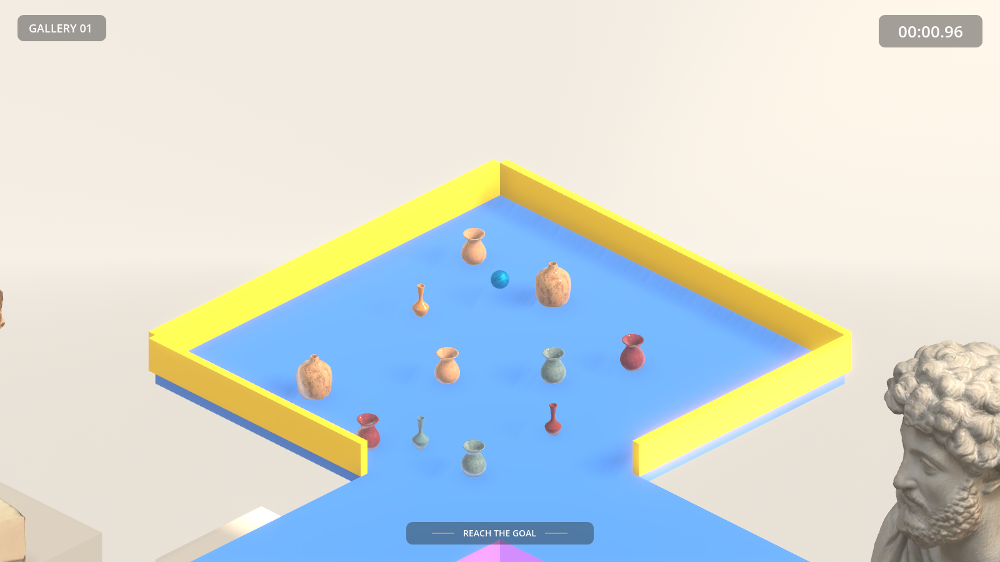
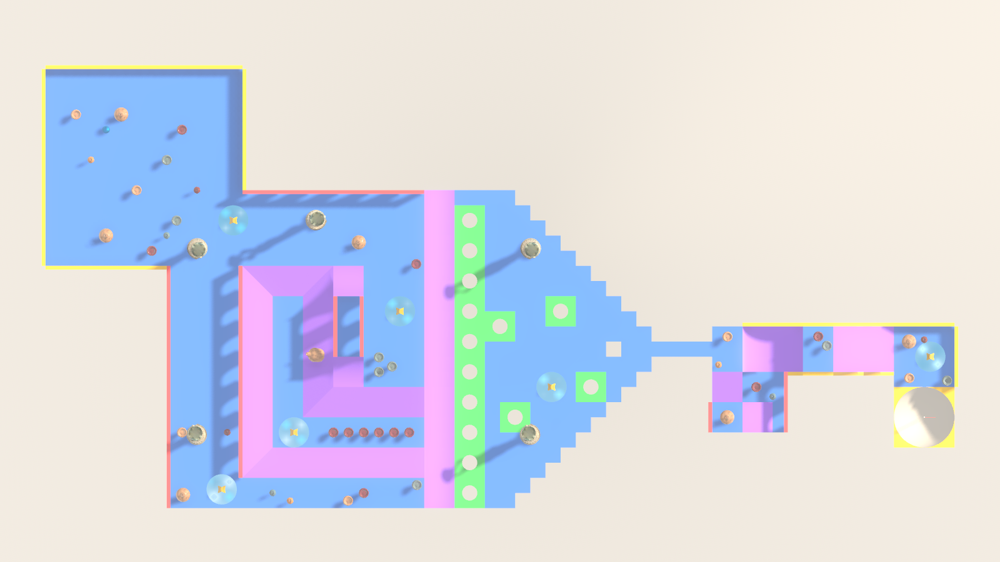
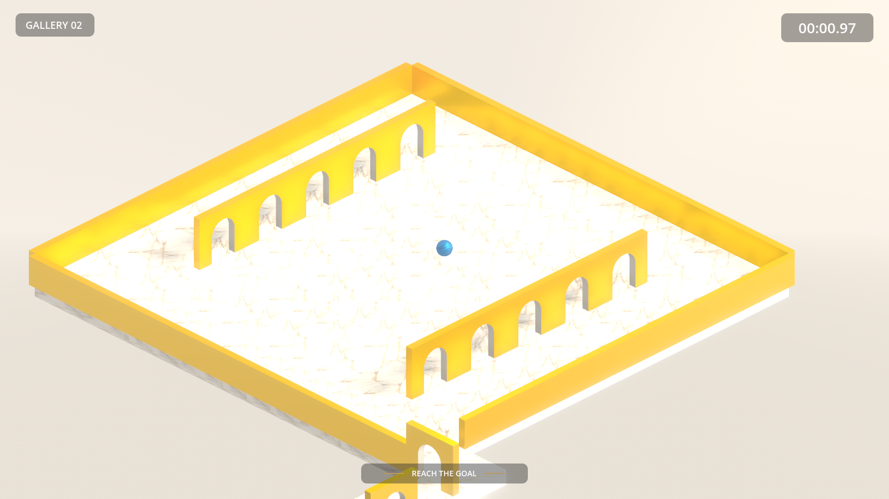
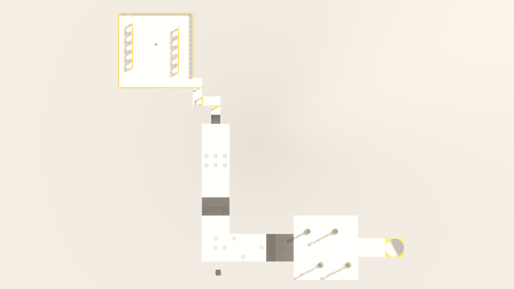
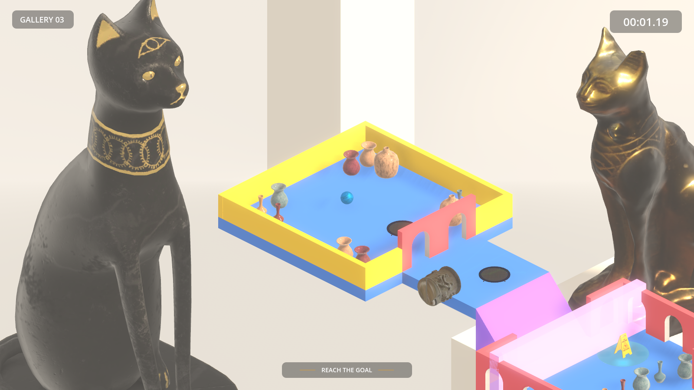
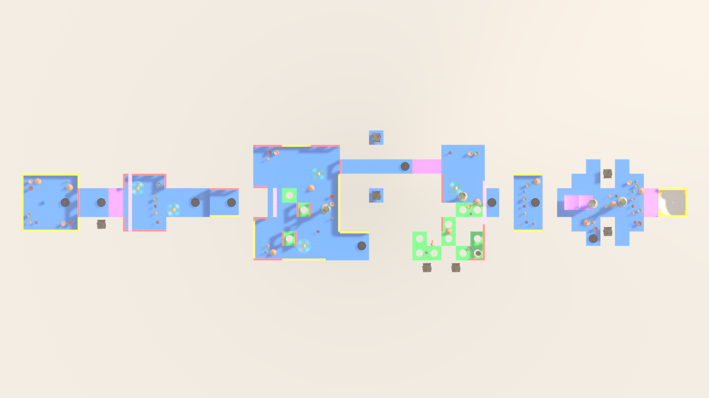

# Marble Madness 3D: Design Document

**Course:** COSC2349 Games Studio 2, Assignment 3
**Team (Group 5):** Donovan Ong, Aaron Tran, Andrew Loi, Jayden Bach
**Engine:** Godot 4.7.1 (.NET), gameplay code in C#
**Video demonstration:** [`VIDEO_DEMO.mp4`](../VIDEO_DEMO.mp4) in the repository root

## 1. Concept

Marble Madness 3D is a physics-driven clone of Atari's *Marble Madness* (1984). It is set inside a bright, high-key museum. The player rolls a glass marble through three gallery wings, each built from the same modular kit of tiles. The aim is to reach each wing's goal as quickly as possible while avoiding falls and hazards.

The original game's isometric view, time pressure and hazards that push the marble off course are kept. The setting is reworked: in place of an abstract arcade grid, each course is a museum exhibit. The hazards are museum objects: a caryatid statue that patrols its plinth, an antique well that pulls the marble in, and a freshly mopped floor behind a wet-floor sign.

### Design pillars

1. **Weight you can feel.** The marble is a real rigid body pushed by forces, never moved directly. Every slope, bounce and knockback comes from the physics engine, so skill means managing momentum.
2. **Readable from above.** A fixed isometric camera, clear tile shapes and clear hazard silhouettes let the player plan a line before committing to it.
3. **Short runs, worth replaying.** Each wing takes one to two minutes. A stopwatch, three-star grades and saved best times reward taking each course again more cleanly.
4. **One kit, many rooms.** Every course is assembled from the same set of tiles. A new wing comes from a new layout, its own exhibits and its own music, not new geometry.

### Visual style and lighting

- **Look:** a bright, high-key museum gallery in warm light. The course is built from colour-coded tiles (blue floors, purple slopes, green hole tiles, yellow rails, red arches) that read clearly against pale columns and exhibits, with the blue marble and the red goal flag standing out. The flat, bright colours give the course an almost abstract-art feel, a deliberate contrast with the classical statues and museum objects around it.
- **Lighting:** one low, warm directional sun (about 40° above the horizon) casts long diagonal shadows across the tiles. A shared environment (`resources/environments/Gallery.tres`) adds a warm procedural sky for ambient and reflected light, SSAO for contact shadows in corners and under arches, a light glow, and height fog so the backdrop below the course fades into haze.
- **Backdrop:** each level has its own exhibit backdrop below and behind the course: columns and arches with themed exhibits. Gallery 01 shows classical and Egyptian busts (Marcus Aurelius, a horse head, two Egyptian heads), Gallery 02 Greek vases and amphorae, and Gallery 03 Egyptian sculptures and cat statues. Most are photogrammetry scans.
- **Readability:** shadows stay sharp because the orthographic camera sits close to the marble and the shadow range is tightened to the play area (§12). Wherever scenery hides the marble, it shows through as a see-through copy of itself (§4).

## 2. Core loop and controls

**Loop:** pick a gallery → roll to the goal, using checkpoints as safety nets → get a time and a 1–3 star grade → retry for a better grade, or unlock and play the next gallery.

| Input | Action |
|---|---|
| WASD / arrow keys | Roll the marble, relative to the camera (W rolls up the screen) |
| Mouse wheel / Q, E | Step through five camera zoom levels |
| Esc | Pause and resume; back out of menu sub-screens |
| Mouse / keyboard | All menus are navigable with either |

The original arcade machine used a trackball. The team considered two schemes: tilting the whole level, or pushing the marble directly. Direct force was chosen in Week 1. It is easier to tune and keeps the camera and level static, which matters for readability. It also maps cleanly to keyboard input.

## 3. Marble physics and control

The marble (`scenes/marble/Marble.tscn`, `scripts/Marble/MarbleController.cs`) is a `RigidBody3D`. Movement applies a central force every physics tick in the direction of the input. Velocity and position are never set directly.

| Parameter | Value | Why |
|---|---|---|
| Radius | 0.25 m | Four marble-widths per 2 m tile, so narrow paths are possible |
| Mass | 1 kg | Godot's default, the baseline for all force values |
| Move force | 12 N | Enough to climb a one-tile ramp from a standing start, but not to stop instantly on a downhill run |
| Max speed | 8 m/s | At this speed the part of the input that would speed the marble up is dropped, but steering and braking still work. Gravity can still take it faster downhill, while the player can't power past it on the flat |
| Bounce | 0.5 | Landings visibly bounce once or twice and then settle |
| Continuous collision detection | On | Stops the marble tunnelling through thin tiles at high speed |
| Physics tick rate | 120 Hz | Doubles the default, for smoother contact with tile seams and ramp edges |

**Camera-relative input.** The camera looks at the level from a 45° angle. When input was mapped to world axes, pressing W rolled the marble diagonally up-left on screen. The controller now takes the active camera's forward and right vectors and flattens them onto the ground plane, then builds the force from them. That way, W, A, S and D always mean up, left, down and right on screen. Flattening matters because otherwise the camera's downward pitch would push the marble into the floor. The controller reads the camera from the viewport rather than referencing the camera rig, so the two systems stay decoupled.

**Hazard reactions.** The marble exposes three reactions that hazards call:

- `GetHitPhys(position)` handles contact with a caryatid. It applies a horizontal impulse directly away from the hazard and takes away control for `KnockbackSpinoutSeconds` (0.6 s).
- `GetHit()` handles the wet floor. It takes away control for `SlipSpinoutSeconds` (1.0 s) with no impulse, so the marble slides on with its own momentum.
- `GetHitTramp(position)` handles a trampoline. It cancels any downward speed, so every bounce reaches the same height, then launches the marble upwards with a slight nudge away from the trampoline's centre.

During a spin-out, further hits are ignored, so a marble can't be stuck in a loop of repeated knockbacks. Each spin-out is numbered, so a timer left over from an earlier hit can never end a later spin-out early. The marble raises `Hit` and `Slipped` signals for the hazard sounds.

**Death and respawn.** Falling into a kill zone calls `Die()`. This puts the marble back at the last checkpoint with zero velocity and fires a `Died` signal, which plays the fall sound. The level does not reload. Once the level has ended, `Die()` and input are both ignored, so a fall at the final moment can't restart a finished run behind the results screen.

## 4. Camera

`CameraRig` (`scripts/Camera/CameraRig.cs`) follows the marble at a fixed isometric angle: a pitch of −30° and a yaw of 45°. The −30° pitch is the flatter, classic isometric-game look, which shows more of the course ahead than true isometric (−35.26°). It uses an orthographic `Camera3D`, which keeps distances readable and matches the original game's flat projection.

- **Smoothing:** the rig moves its position toward the marble each physics tick using exponential smoothing (`1 − e^(−k·Δt)`). Unlike a fixed-alpha lerp, this gives the same feel at any frame rate. The rig never rotates, so the viewing angle never changes.
- **Zoom:** five levels (orthographic sizes 5, 7, 10, 15 and 20, starting at 15), stepped with the mouse wheel or Q/E and eased with the same smoothing. Camera distance scales with zoom:
  - zoomed out, the near edge of the frame never clips behind the camera;
  - zoomed in, the camera sits closer, keeping directional shadows sharp.
- **Never losing the marble:** the camera always looks straight at the marble from above the level, on the side facing the backdrop. Arches, columns and props can still pass between them, so wherever the marble is hidden it shows through as a see-through copy of itself, using its own texture at 45% opacity. This uses the stencil buffer: the marble marks the pixels where it is directly visible, and a second pass of its material, with depth testing off, fills in only the hidden pixels. An always-on outline was tried first and replaced (§13).
- **Fading the backdrop:** large exhibits in the backdrop can still hide the tiles around the marble. `BackdropFader` fades any backdrop prop out to a faint ghost while it covers a 2 m circle around the marble on screen and sits in front of it, then fades it back in. A quick bounding-box check rules out props that are nowhere near, and rays cast towards the camera from the marble and two rings of points around it test the prop's actual triangles, so a prop only fades when it really is in the way. Only the level's backdrop is affected; tiles, vases and hazards always stay solid.

## 5. Tile system

### 5.1 Grid convention

Every tile follows `docs/tile-convention.md`:

| Rule | Value |
|---|---|
| Footprint | 2 m × 2 m, origin at the footprint centre |
| Walking surface | y = 0 at the tile's base height |
| Elevation step | 1 m, so a one-tile ramp is a 2:1 slope of about 27° |
| Rotation | 90° steps around Y only; tiles are never scaled in a level |
| Connections | Flush edges at ±1 m; neighbouring surfaces match or differ by exactly one step |

An early 4 m footprint was dropped for 2 m in Week 1. The finer grid lets curves, forks and one-tile bridges be assembled from small pieces instead of special-case geometry.

### 5.2 The kit

Ten tile types, each a scene in `scenes/tiles/`:

| Tile | Role |
|---|---|
| Flat | Standard track |
| Half | Half-width (1 × 2 m) flat slab, for narrowing a path or filling a gap |
| Ramp | One-step slope between elevations |
| Steep | Two-step slope, for fast drops in later levels |
| Ramp Corner | Turns 90° while changing elevation |
| Curve | Rounded 90° turn on the flat |
| Hole | Slab with a cut-out; the ring around it can be rolled, the centre is a fall |
| Wall | Rail that keeps the marble on track, or shapes mazes |
| Arch | Gateway the marble rolls under; frames routes and reads as "museum" |
| Goal | Goal platform, marked with a red flag |

### 5.3 Tile library and GridMap

The kit is a `MeshLibrary` (`assets/libraries/tile_library.tres`) built from the ten tiles, with colour-coded tiles: blue floors, purple slopes, green hole tiles, yellow rails and red arches. Levels are painted onto a Godot `GridMap` with it (cell size 1 × 0.5 × 1 m, so the 2 m tiles snap cleanly).

Marble, sandstone and a muted marble-and-brass look were all tried as per-gallery themes, each as its own library. The team settled on the colour-coded set for every level, for two reasons. Each tile type reads instantly at a glance, so slopes, holes and rails are easy to spot from the camera's height. And the bright, flat colours give the course an almost abstract-art feel that contrasts with the classical statues and museum objects around it. The galleries are told apart by their exhibits and music instead. The unused marble and sandstone libraries, with their tile scenes, materials and textures, were removed before submission.

Materials are shared resources in `assets/materials/`. Each one is a `StandardMaterial3D` that uses triplanar mapping with CC0 PBR textures (see `docs/credits.md`), so any tile shape textures cleanly without UV work. Each tile type has its own colour, and the goal flag is red, so the player's eye is drawn to the goal.

Painting levels onto a GridMap, rather than placing tile scenes one by one, keeps level files small. GridMap also batches its meshes into octants, which cuts draw calls on the largest level (see §12).

## 6. Level design

All three levels share the same structure. Each has:

- a start marker (`PlayerStart`) on the highest tier;
- a descent across several elevations to the goal, marked with a red flag;
- checkpoints placed after each major hazard section;
- a kill zone below the level to catch falls.

Each level holds only its own tiles, triggers, hazards, props and backdrop. The marble, camera, HUD and menus live in a shared shell (§11.2).

### Gallery 01: Stone Hall (introduction)

- **Theme:** the colour-coded tiles, with classical and Egyptian busts in the backdrop.
- **Layout:** a 7 m descent from the top-floor landing to the goal's rim, winding down through seven floor heights via ramps, steep drops, curves, arches and hole tiles.
- **Teaches:**
  1. Rolling and stopping on flat ground.
  2. Taking ramps under control.
  3. Avoiding the centre of hole tiles.
  4. Knocking over display vases at the first landing, which slows the marble without punishing it (§7.1).
  5. Meeting the two simplest hazards: five patrolling caryatids, whose knockback is easy to see and survive, and six wet-floor puddles, where the loss of control is harmless.
- **Checkpoint:** one, at the midpoint.
- **Difficulty:** wide paths, few drops without a rail, generous star times.

### Gallery 02: Marble Hall (combination)

- **Theme:** the colour-coded tiles, with Greek vases and amphorae in the backdrop.
- **Layout:**
  1. It opens in a walled maze on the top floor. The player must find the single exit, an arch in one corner.
  2. It then drops 4 m over three tiers to a lower hall.
- **Escalation:**
  - Hazards are combined rather than isolated: six caryatids, four vacuum wells, three blowers, fourteen trampolines and a wet floor. In the lower hall the caryatids patrol crossing paths, so the player has to time a gap between them.
  - A row of vacuum wells sits beside the route, so a knockback near them can drag the marble off the edge.
  - Paths narrow to one tile in places.
- **Checkpoints:** three, including the maze exit and before the caryatid hall.
- **Difficulty:** first real test of route-finding and timing; longer star times to fit the maze.

### Gallery 03: Egyptian Wing (mastery)

- **Theme:** the colour-coded tiles, with Egyptian scans in the backdrop: Priest Ahmose and his mother, an Egyptian sculpture, Egyptian heads, Amenemhat III and cat statues.
- **Layout:** the longest course, about 94 m from the start room to the goal, dropping 8 m to the goal's rim.
  1. **Start:** a walled start room exits through arches onto a corridor with two trampolines and a blower beside it, then the first steep 2 m drop onto a landing with two wet floors.
  2. **Trampoline pit:** the route drops 1 m into a pit. The exit ledge is back at the entry height, so the only way out is a trampoline bounce, and a missed bounce can simply be retried. A second trampoline waits on the ledge.
  3. **Central court:** a ramp leads down into a court with hole tiles, two wet floors and a patrolling caryatid.
- **Fork:** the court has two exits.
  - The short route crosses a one-tile bridge with no rails, between two vacuum wells on their own pads. Their wind cones point at the bridge from either side, so any drift is pulled further off line, and a trampoline waits at the far end.
  - The long route drops down a steep ramp after a trampoline, onto a lower field of hole tiles with two blowers along its edge.
  - The two routes meet again in a hall with a caryatid and a wet floor.
- **Trampoline gap:** from the hall, a take-off tile with a trampoline launches the marble across a 2 m gap to a ledge 1 m higher, where another trampoline waits.
- **Final hall:** two caryatids patrol and two vacuum wells pull across a wide hall, with one more trampoline, before the last steep drop to the goal.
- **Checkpoints:** three: after the first steep drop, at the court entrance, and where the routes rejoin.
- **Difficulty:** tightest margins in the game, with every hazard type appearing together; the short route is faster but riskier.

### Difficulty progression

| | Gallery 01 | Gallery 02 | Gallery 03 |
|---|---|---|---|
| Hazards | 5 caryatids, 6 wet floors | 6 caryatids, 4 vacuum wells, 3 blowers, 14 trampolines, 1 wet floor | 4 caryatids, 4 vacuum wells, 3 blowers, 9 trampolines, 5 wet floors |
| Hazards combined? | Two simple types | Crossing caryatids; knockback near the wells | All types together |
| Narrowest path | 2 tiles | 1 tile with rails | 1 tile without rails |
| Signature feature | Hole tiles | Opening maze | Route fork, steep drops |
| Checkpoints | 1 | 3 | 3 |
| 3 / 2 / 1-star times | 30 / 60 / 300 s | 50 / 80 / 300 s | 75 / 120 / 300 s |

Star times grow with each gallery's length. They are kept in `LevelCatalog`, next to each level's scene. Levels unlock in order: a gallery opens once the previous one has been cleared with at least one star.

## 7. Hazards

All hazards sit on the Hazards physics layer and react only to the marble. Each one either calls the marble's public reaction methods or pushes it with forces, so no hazard needs to know how the marble works internally. The vacuum well and blower share their force code in a `RadialForceHazard` base class.

| Hazard | Model | Behaviour | Response |
|---|---|---|---|
| **Caryatid** (moving) | Photogrammetry caryatid statue | Kinematic body following a `Path3D` patrol route at a set speed, looping. The route is captured in world space when the level loads, so a scaled-up statue follows a correctly scaled path. | Knockback away from the statue plus 0.6 s without control |
| **Vacuum well** (environmental) | Decimated well model plus animated wind VFX | Only while the marble is inside its cone-shaped wind area (about 4 m long), pulls it toward the well. The pull is strongest near the well and falls off linearly to zero at 5 m (20 N at full strength). Wind ribbons scroll inward to show the pull. | Continuous force; the player must steer out. Falling in is a fall like any other. |
| **Blower** (environmental) | The same well model with the wind reversed | The well's mirror image: inside its wind cone it pushes the marble away (20 N at the mouth, fading to zero at 5 m), with the wind ribbons scrolling outward. | Continuous push, used to shove the marble towards an edge or a hazard |
| **Trampoline** | Trampoline model | Trigger area on the floor | Launches the marble upwards with a springy sound; every bounce reaches the same height, which lets levels put ledges and gaps that can only be crossed with a bounce |
| **Wet floor** (stationary) | Wet-floor sign beside a puddle decal | Trigger area on the floor | 1.0 s without control; the marble keeps its momentum |

The well's suction comes from the original game's vacuums. The wet floor turns the original's acid pools into a museum gag: it never kills the marble, but a spin-out at the wrong moment can carry it off an edge. Hazards are therefore dangerous because of where they're placed, which is why the level design puts them near drops in later galleries.

### 7.1 Knock-over props

Display vases (`scenes/props/vases/`, seven in three shapes) are loose physics props, not hazards. They stand still until the marble hits them, then topple and take some speed off it: at a normal 4 m/s the marble keeps about 60% of its speed. That makes a crowded room both fun and a natural brake. Each vase scene inherits shared physics settings from `VaseBase.tscn` and uses the reusable `KnockableProp` script. Two fixes made them feel right:

- **Centre of mass.** Godot placed the automatic centre of mass at the collision shape's origin, the vase's base, so fallen vases swung back upright like weebles. `KnockableProp` sets it at 45% of the vase's height instead.
- **Topple push.** The marble strikes low on a vase's rounded body, so plain physics either slid the vase or tipped it back onto the marble, wedging the two together. A trigger zone slightly larger than the vase detects the marble just before contact, while its approach speed can still be read, and adds a push high on the vase in the marble's direction of travel, scaled by that speed.

At a normal 4 m/s every vase topples and settles within a few seconds; gentle bumps only shove the wider vases. A vase knocked off the level is removed so it doesn't keep falling forever.

## 8. Timer, checkpoints, win and lose

- **Stopwatch and limit:** `LevelTimer` counts up from zero and is visible on the HUD at all times. Every level has a hard 5-minute limit: at 5:00 the run ends in a game over ("Timer expires"). Star times reward speed: each gallery has its own three- and two-star times (§6), and any finish inside the limit earns one star. This keeps the original game's pressure to beat the clock while rewarding faster play with a grade.
- **Checkpoints:** passing a checkpoint updates the respawn point in the `CheckpointManager` autoload. A fall respawns the marble there instantly; the level does not reload and the clock keeps running. Each new attempt clears the old checkpoint, so one never carries over into another run or level.
- **Win:** reaching the goal calls `GameStateManager.Win()`. The marble stops responding, the timer freezes, and the results screen shows the grade.
- **Lose:** reaching the 5-minute limit ends the run on the game-over panel, with Try Again, Level Select and Main Menu.
- **Ended state:** `GameStateManager` keeps a single ended flag that the marble, timer, pause menu and results screen all read directly. Each new run clears it when the marble loads, so retrying or moving to another level always starts live.
- **Progress:** best time and best stars per level are saved to `user://progress.cfg` by `ProgressStore`, and shown on the results screen and level select.

## 9. UI and menus

The UI has its own look: cream panels, a muted gold accent, and the Diffusion typeface for headings and body text.

| Screen | Content |
|---|---|
| **Start menu** | A live 3D gallery backdrop with a slowly drifting camera. (A crossfading screenshot slideshow is also supported, but the 3D backdrop is used instead.) Buttons: Start Game, Level Select, How to Play, Settings (master volume), Quit. |
| **Level select** | One card per gallery, switched with the arrows, the dots, or left/right keys. Each card shows an in-game picture of the gallery, earned stars, best time, and Play / Play Again / Locked. Locked galleries show a padlock and the requirement to unlock them. A counter shows total stars out of 9. |
| **HUD** | Gallery name top-left, stopwatch top-right (mm:ss.cc), and a "Reach the goal" objective that fades after six seconds to keep the screen clear. The same strip shows "Checkpoint reached" for 2.5 s at each new checkpoint. Only one message is shown at a time: a new one fades out the old one and restarts the timer, so two in quick succession never overlap or cut each other short. |
| **Pause** | Esc dims the level and freezes the game, the timer included. Offers Resume, Restart and Main Menu. Disabled once the level has ended. |
| **Results** | Win panel: animated stars, the time, "NEW BEST" or the previous best, and the three star thresholds with the earned tier highlighted. Game-over panel: the reason and the time. Next, Retry, Level Select and Main Menu are offered as they apply, so no screen is a dead end. |

All screens use Godot containers and anchors, so they scale across common desktop resolutions and aspect ratios. The 3D backdrop scales to cover the whole window at any size.

## 10. Audio

| Sound | Implementation |
|---|---|
| **Rolling** | A looping glass-on-wood recording whose volume and pitch rise with rolling speed. Only speed along the ground surface counts, so a landing doesn't cause a burst of rolling sound. It is silent while airborne. The loop never stops, only its volume changes, which avoids clicks. |
| **Landing** | A clunk that plays when the marble goes from airborne to grounded. Its volume scales with impact speed and its pitch varies randomly, so repeated bounces don't sound identical. Respawns are filtered out. |
| **Props** | Vases play a random glass clink, and the wet-floor sign a soft knock, whenever they're jolted: hit by the marble, hitting the floor as they topple, or bumping each other. Volume scales with the jolt and pitch varies per hit. A prop stays silent until it has first come to rest, so a level full of vases doesn't clink as it loads. |
| **UI** | A click on every button press. A `UiSounds` autoload connects the click to each button as it's added to the scene tree, so no menu needs its own audio code and new buttons get it automatically. It sits above the current scene so the click isn't cut off when a button changes scene, and keeps processing while the game is paused. |
| **Game events** | A `GameSounds` node in `Main.tscn` plays steel drum jingles from one set (a short lift at a new checkpoint, a falling phrase when the marble falls off the level, a rising phrase at the goal and a longer falling one on game over), a thump when a caryatid knocks the marble back, and a light drop when it slips on a wet floor. It only listens to existing signals (`CheckpointManager.CheckpointReached`, `GameStateManager.LevelWon`/`LevelLost`, and the marble's `Hit`, `Slipped` and `Died`), so no gameplay script contains audio code. Re-crossing a checkpoint that's already set stays silent. An earlier swoosh for falls felt jarring, so falls use a jingle from the same steel set, played quieter than the others because it's heard most often. It keeps processing while paused, because the result screen pauses the game as the jingle starts. |
| **Trampoline** | A springy jump sound, played by the trampoline's own sound player from its existing contact signal. |
| **Music** | A `MusicPlayer` autoload crossfades between tracks as scenes change, and keeps playing through retries and pauses. Each scene names its track with a `MusicCue` node. |

Music is public-domain-era piano repertoire, chosen to suit a quiet gallery and to tell the wings apart:

| Scene | Track |
|---|---|
| Start menu and level select | Satie, *Gymnopédie No. 1* |
| Gallery 01 | Debussy, *Arabesque No. 1* |
| Gallery 02 | Satie, *Gnossienne No. 1* |
| Gallery 03 | Ravel, *Pavane pour une infante défunte* |

The marble's sounds are not positional: the camera always follows the marble, and a 3D sound would get quieter as the camera zooms out.

## 11. Technical architecture

### 11.1 Systems and ownership

Each system is a separate script, in a folder named after the system. Systems talk through signals and four autoloads, never through direct references to each other.

| System | Key scripts | Talks to others via |
|---|---|---|
| Marble | `MarbleController` | Reads the camera from the viewport; exposes `Die()`, `GetHit()`, `GetHitPhys()`, `GetHitTramp()`; emits `Hit`, `Slipped` and `Died` |
| Camera | `CameraRig`, `BackdropFader` | The rig follows a target `NodePath`; the fader reads the camera, marble and level backdrop |
| Level | `LevelLoader`, `Checkpoint`, `Goal`, `KillZone`, `LevelTimer` | Calls the autoloads; the timer emits `TimeChanged` |
| Hazards | `MovingHazard`, `RadialForceHazard` (base of `VacuumHazard` and `BlowerHazard`), `StationaryHazard`, `TrampolineHazard` | Call the marble's reaction methods, or apply forces while it's in their area |
| UI | `StartMenu`, `LevelSelect`, `GameHud`, `PauseMenu`, `ResultScreen` | Listen to `TimeChanged`, `LevelWon` and `LevelLost`; read `ProgressStore` |
| Audio | `MusicPlayer`, `MusicCue`, `UiSounds`, `GameSounds`, `MarbleRollSound`, `MarbleImpactSound`, `PropImpactSound` | Child nodes read the marble's physics state; `GameSounds` listens to game signals; music is cued by scenes |
| Props | `KnockableProp` | Physics only; recognises the marble by its `marble` group |
| Core (autoloads) | `GameStateManager`, `CheckpointManager`, `MusicPlayer`, `UiSounds` | Signals; state shared by the whole level |

Two examples of the decoupling:

- `MarbleController` contains no audio code. The sound nodes are its children and only read its velocity.
- `LevelTimer` doesn't know the HUD exists. It only emits the time.

### 11.2 Shared shell and level loading

`scenes/main/Main.tscn` is a shell that every level is played inside. It holds:

- the marble and camera rig;
- lighting and the gallery environment;
- the HUD, pause menu, timer and results screen.

The backdrop used to live in the shell too. It moved into each level scene so every gallery can show its own exhibits.

The level select records the player's choice in `GameSession`. `LevelLoader` then loads that level into the shell, places the marble at its `PlayerStart`, and tells the HUD and results screen which level is running.

Adding a gallery takes a new level scene, one line in `LevelCatalog` (its scene and star times) and a picture for its level-select card. The marble, camera and UI are never duplicated per level.

### 11.3 Physics layers

| Layer | Name | Contents | Detects |
|---|---|---|---|
| 1 | World | Tiles, level geometry, knock-over props | Props detect World and Marble |
| 2 | Marble | The marble | World, Hazards |
| 3 | Hazards | Caryatids, vacuum wells, blowers, wet floors, trampolines | Marble |
| 4 | Triggers | Goal, checkpoints, kill zones | Marble |

## 12. Performance

Final measurement, 20 Oct, with all three levels finished, on an Apple M4 laptop (16 GB) at 1920 × 1080 with vsync off, playing each level for 20 s with the marble rolling:

| Level | Average FPS | 1% low | Minimum | Draw calls (avg) | Triangles (peak) |
|---|---|---|---|---|---|
| Gallery 01 | 183 | 140 | 71 | 170 | 372k |
| Gallery 02 | 180 | 120 | 66 | 186 | 352k |
| Gallery 03 | 199 | 143 | 27 | 167 | 199k |

All three levels stay well above the 60 FPS target: the 1% lows are all 120 FPS or more. The minimum column is a single worst frame. The one dip below 60 (Gallery 03) is an isolated one-frame hitch rather than sustained slowdown; in repeat runs such hitches fall at different moments, so they aren't tied to one spot in a level. Earlier measurements, with fewer props and hazards and reflections still on, were 162 and 157 FPS for Galleries 01 and 02 on 17 Oct.

**Optimisation candidates.** Before the final measurement, four candidates were each measured on their own against the same baseline (reflections on, levels as they were that morning), toggled at runtime:

| Change | Gallery 01 | Gallery 02 | Gallery 03 | Decision |
|---|---|---|---|---|
| Screen-space reflections off | 148 → 166 (+12%) | 147 → 183 (+24%) | 160 → 203 (+27%) | **Applied.** Largest gain, and the tiles are matte, so side-by-side renders look the same apart from slightly softer reflections on glossy exhibits |
| Soft shadow filter High → Low | 148 → 161 (+9%) | 147 → 151 (+3%) | 160 → 170 (+6%) | Not applied: a small gain for harder shadow edges, with plenty of headroom already |
| Backdrop props cast no shadows | 148 → 148 | 147 → 140 | 160 → 160 | Not applied: no gain, so shadow geometry isn't the bottleneck |
| Physics at 60 Hz instead of 120 Hz | 148 → 135 | 147 → 154 | 160 → 159 | Not applied: no gain, so rendering, not physics, is the bottleneck |

Gallery 02 was re-measured on 17 Oct after five Greek vase scans were added to its backdrop. Its average went from 180 to 157 FPS. A 181k-triangle Borghese vase scan was swapped for a 2.8k-triangle vase during this pass, and the heaviest remaining scan, the Ancient Greek vase at 99k, is used only once. The triangle column is the peak in any single frame. It isn't the sum of the models: Godot generates lower-detail versions of every imported model and uses them when a model is small on screen, and shadows draw some objects twice, so the count depends on where the camera is. Zoomed out over the whole level, all five vases together cost about 53k triangles.

- **Model budget:** an early measurement found the "decimated" hazard models still had over 1 million triangles each, about ten times the statue props. The well was re-decimated in Blender from 1.25 M to 37.6 k triangles (−97%, 41.8 MB → 1.9 MB) and replaced under the same import ID, so no scenes changed. The largest models in play are now the Marcus Aurelius bust (104k triangles), the horse head (69k) and the caryatid (44k, six of them in Gallery 02). The vases are 1.7k–3.4k each.
- **GridMap:** levels render tiles in batched octants instead of hundreds of separate nodes, which keeps draw calls low on large layouts.
- **Shadows:** one directional light. Shadow distance is tightened to the play area, and the orthographic camera sits 15 m from the marble, inside that range. This keeps shadow detail high without raising shadow-map cost.
- **Physics:** continuous collision detection is enabled only on the marble. Hazards are kinematic or static bodies, and knock-over props sleep until they're hit. Triggers are simple `Area3D` shapes on their own layer, masked to the marble only.
- **No runtime allocation in hot paths:** respawning moves the existing marble instead of creating a new one. The only object ever removed during play is a vase knocked off the level, and nothing is created, so object pooling is unnecessary.
- **Rendering settings:** 4× MSAA and SSAO give the bright gallery look at a fixed, predictable cost; screen-space reflections are off (see the table above). Fog hides the far backdrop, so distant detail is never rendered sharply.
- **Backdrop fading:** `BackdropFader` builds each backdrop prop's triangle data once when the level loads (about 70 ms), and each frame tests only the props whose bounds are near the marble, so the per-frame cost is small.

## 13. Playtesting and iteration

Changes made in response to testing, in roughly chronological order:

| Observation | Change |
|---|---|
| A 4 m tile grid made curves and forks blocky, with too few placement options | Grid reduced to 2 m (four marble-widths) with a 1 m elevation step |
| Shadows were missing or blocky in game but sharp in the editor | The camera sat beyond the shadow range; pulled it in to 15 m (no change in framing under orthographic projection) and tightened the shadow settings |
| Falling just as time ran out let the marble respawn and keep playing behind the game-over screen | The marble now checks the shared ended flag directly, for both input and respawn, instead of keeping its own copy |
| Under the 45° camera, W rolled the marble diagonally on screen | Input made relative to the camera |
| A 2 s loss of control from a moving hazard felt like a punishment | Reduced to 0.6 s, with a knockback impulse so the cause is visible; 1.0 s for the wet floor |
| A countdown timer made new players rush and fall, and gave experienced players no reason to replay | Changed to a stopwatch with three-star grades and saved best times; finishing past the 1-star time is still a loss |
| Rolling sound burst loudly on every landing | Only speed along the ground surface counts as rolling |
| Respawning played a hard landing clunk at the checkpoint | Landing sound ignores the step in which the marble respawns |
| The marble won before it visibly reached the goal | Goal trigger shrunk and marked with a flag (now red) |
| Hazards scaled up for Gallery 02 followed tiny, unscaled patrol paths | Patrol paths captured in world space, so they scale with the statue |
| Gallery 02's lower hall was too crowded at the original speed | Reduced from five caryatids to four, and patrol speed from 2.0 to 1.5 |
| After a win, Retry or the next level started with a frozen marble | The ended state is cleared whenever a new marble loads |
| Hazards placed in the shared shell appeared in every level | Hazards moved into the level that owns them |
| Knocked-over vases stood back up, or tipped back onto the marble and wedged it | Centre of mass raised to 45% of the vase's height, plus a speed-scaled push detected just before contact (§7.1) |
| The marble disappeared behind arches, columns and vases | Tried an always-visible outline first, then replaced it with a see-through copy of the marble wherever it's hidden (§4) |
| Marble, sandstone and muted marble-and-brass tile themes made slopes, holes and rails harder to tell apart from the camera's height | Kept the colour-coded tile set for every gallery, and themed each gallery with its exhibits and music instead (§5.3) |
| Several lighting set-ups were tried to make the brighter themes less washed out | With the colour-coded tiles back, the original lighting was kept |
| Large backdrop exhibits sometimes hid the tiles right next to the marble | Added backdrop fading (§4). Its first version used bounding boxes and faded a vase that wasn't near the marble at the start of Gallery 02, so it now tests each prop's actual triangles |
| The blower's wind effect scrolled inward, so it read as suction | The blower now plays the reversed, outward animation |
| Wells pushed and pulled the marble from any direction within 5 m, even through floors, until it had passed through their wind once | Found in a code audit: the force now applies only inside the wind cone (§7) |
| Every gallery used Gallery 01's star times, so the longer Galleries 02 and 03 were far harder to grade well on | Star times are now set per level in `LevelCatalog`, longer for longer galleries (§6) |
| There were no sounds for checkpoints, winning, losing or hazard hits | Added game-event sounds (§10). The first fall sound felt jarring, so all the event jingles now come from one steel drum set, with the fall sound played quieter than the rest |

## 14. Team roles

| Member | Role | Owned systems |
|---|---|---|
| **Donovan Ong** | Head of core gameplay mechanics | Marble controller, camera, physics layers, checkpoint, timer and win/lose base systems, lighting and backdrop, backdrop fading, music system, marble and game-event sounds, knock-over props, see-through marble, the Gallery 03 layout and the later development of all three galleries (vases and hazard placement), code audit, performance, documentation |
| **Aaron Tran** | Technical lead, level systems | Tile kit and the three themed GridMap libraries, the original Gallery 01 and 02 layouts and their integration |
| **Andrew Loi** | Gameplay systems | Caryatid, vacuum well, blower, trampoline and wet-floor hazards and their VFX; how the marble reacts to hazards; hazard models |
| **Jayden Bach** | Polish, UI and support | Start menu, level select, HUD, pause menu, results screen and progress saving, level loading, menu backdrop, audio polish |

Work was done on feature branches per system and merged to `main` once reviewed. Individual contributions are recorded in the commit history.

## 15. Scope

**Delivered from the stretch goals in `docs/requirements.md`:**
- Best time per level, saved locally and shown on the results and level select screens (§3.5).
- Photogrammetry models: British Museum and IU Indianapolis scans used as backdrop props and hazards (§3.3).
- Level progression with locks and star grades.
- Physics-interactive obstacles: knock-over vases that the marble can topple, and trampolines that launch it (§3.4's physics-interactive stretch goal).

**Deliberately left out**, to protect polish on the three galleries:
- Phone-gyroscope tilt control.
- Selectable marble skins.
- A level editor exposed to players.

## 16. Credits

All third-party models, textures, music and sound effects, with their sources and licences, are listed in `docs/credits.md`.
